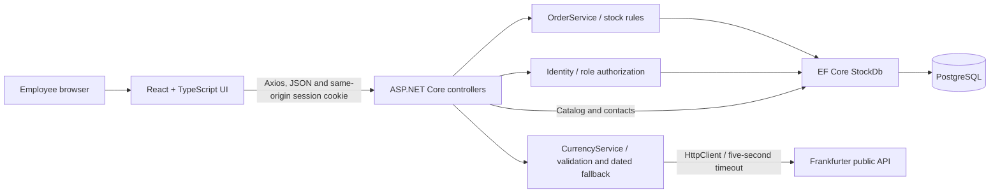
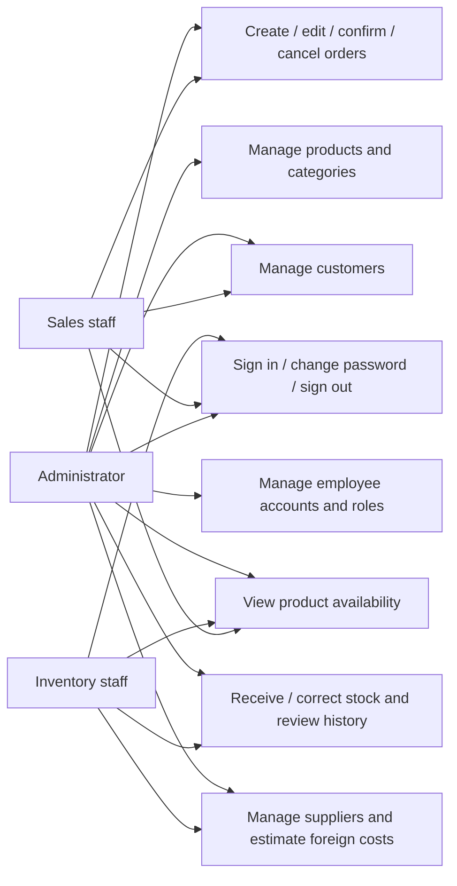
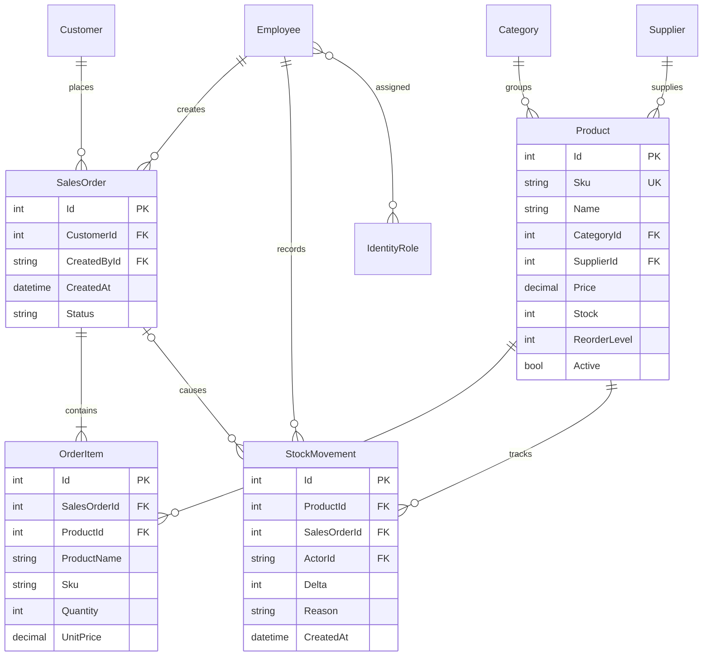

# Proposal, requirements and design

## Proposal

**Title:** StockFlow — Small Business Inventory and Order Management. **Audience:** small retail teams using notebooks and disconnected spreadsheets. **Problem:** inaccurate inventory, duplicated entry, overselling, missing stock-change explanations, unrestricted employee access and uncertain foreign supplier costs. **Outcome:** one shared workspace connects records, inventory and sales with accountable stock movements. **Team:** actual 4–5 student names and instructor approval must be added by the team before submission.

**Roles:** Admin manages catalog, categories, accounts and all business operations. Sales manages customers and all sales orders, and views products. Inventory manages suppliers, stock movements and exchange estimates, and views products. Customers are records, not login accounts.

| Requirement | Implementation |
|---|---|
| FR01 authentication, FR02 role access | Identity sessions, lockout, authorization attributes and security stamps |
| FR03 products | List, search, add, edit and archive; normalized unique SKU |
| FR04 categories | Add, list, edit and archive with reference checks |
| FR05 suppliers | Inventory/Admin contact CRUD and archive |
| FR06 customers | Sales/Admin contact CRUD and archive |
| FR07 stock | Atomic positive/negative adjustment and actor/reason/time audit |
| FR08 orders | Create/read/update/delete draft; confirm or cancel |
| FR09 availability | Guarded stock update checks active product and sufficient quantity |
| FR10 synchronization | Transaction commits status, all quantities and all movements together |
| FR11 history | Product names, SKU and unit prices snapshotted per order item |
| FR12 external service | Server-side Frankfurter USD/EUR/GBP/JPY/AUD/CAD/SGD → PHP estimate |
| FR13 safe errors | Controlled ProblemDetails-style responses; no exception text in HTTP 500 |
| FR14 validation | HTML form constraints plus server DTO and business validation |

**Nonfunctional goals:** secure password hashing/server permissions; accessible responsive UI, persistent theme and plain-language feedback; inventory consistency and external-service isolation; reproducible migrations/setup; separated client, API/application and data responsibilities. The proposal's 1,000-product / under-two-second list target requires a controlled benchmark before it can be claimed.

## Architecture



Controllers handle HTTP contracts, authorization and directory/catalog operations; OrderService owns transaction rules; CurrencyService isolates the external dependency; StockDb owns mappings and constraints. This is a Web API with a separate React presentation layer, rather than server-rendered MVC views. Identity avoids custom password cryptography. Custom CSS design tokens provide the visual theme rather than the proposal's optional Tailwind choice.

## Use cases



## Order confirmation sequence

```mermaid
sequenceDiagram
  actor Employee
  participant UI as React / Axios
  participant API as OrdersController
  participant Service as OrderService
  participant DB as PostgreSQL / EF Core
  Employee->>UI: Review and confirm draft
  UI->>API: POST /api/orders/id/confirm
  API->>API: Authenticate and require Admin or Sales
  API->>Service: Transition(id, confirm, actor)
  Service->>DB: BEGIN; SELECT order FOR UPDATE
  DB-->>Service: Current status and saved items
  loop Products sorted by ID
    Service->>DB: UPDATE stock WHERE active AND stock >= quantity
    DB-->>Service: Number of rows changed
  end
  alt All items available
    Service->>DB: INSERT movement per item; UPDATE status; COMMIT
    Service-->>UI: 204 success
    UI->>API: Reload products/orders/history
    UI-->>Employee: Updated records and success message
  else Missing stock or changed state
    Service->>DB: ROLLBACK all changes
    Service-->>UI: 409 with plain-language explanation
    UI-->>Employee: Review stock and try again
  end
```

An order-row lock serializes edits, confirmation, cancellation and deletion of the same order. Guarded product updates lock and check current quantities in PostgreSQL; product IDs are processed in sorted order. Separate competing orders cannot deduct unavailable stock. Repeated confirm/cancel calls are idempotent for the resulting state. Cancel after confirmation restores quantities and writes movements in the same transaction. A canceled order cannot be confirmed. Transaction disposal rolls back errors. Database stock/price/quantity/status constraints provide additional protection.

## ERD



Identity additionally maintains its standard user/role/claim/token/login relationship tables. Prices are numeric(14,2); calculations use decimal. Totals derive from order items instead of storing conflicting totals. Category/supplier/customer foreign keys normalize shared records. Order item name/SKU/price copies are intentional historical snapshots. Timestamps use UTC in PostgreSQL and display in the browser's local timezone. Catalog contacts use soft archives; draft deletion cascades to items; other foreign-key deletes are restricted. StockMovement has a product/time index. Current stock is stored for atomic availability checks and reconciles with recorded movements, including seeded opening quantities.

## UI choices

Emerald primary actions, teal accents, navy text, neutral surfaces, amber restock warnings and red destructive actions use shared CSS variables. Dark mode persists only the theme setting. Native dialogs provide keyboard focus containment and Escape handling; focus returns to the trigger. Forms have visible labels, guidance, validation, pending states and server feedback. Status labels use text as well as color. A skip link, keyboard focus rings and reduced-motion support are included. Mobile navigation collapses; wide record tables scroll inside their panel.

## Development and continuity

Suggested team split: identity/access; catalog/database/stock; orders/customer workflows; UI/Axios/accessibility; external integration/testing/docs. Each member should review and explain an integrated workflow, not only their module. Use feature branches, issues, reviews and meaningful commits. Planned extensions: secure uploads (week 10), operational reports (11), performance/pagination (12), broader automated tests (13), formal security review (14), production containerization/CI (15), integration retrospective (16), individual defense (17–18). Existing transactions and tests give this midterm a foundation for those later topics.
